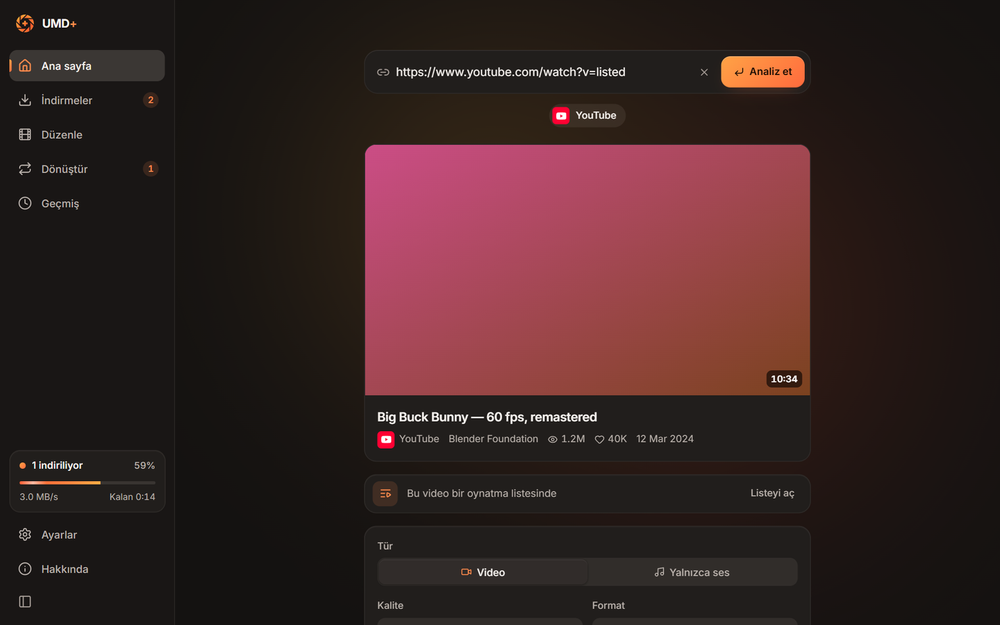
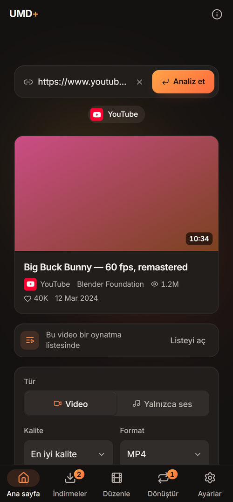
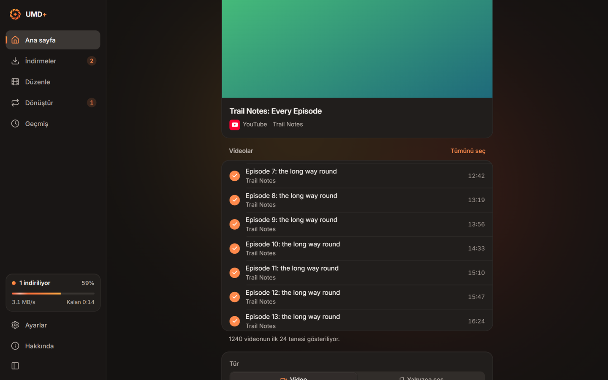
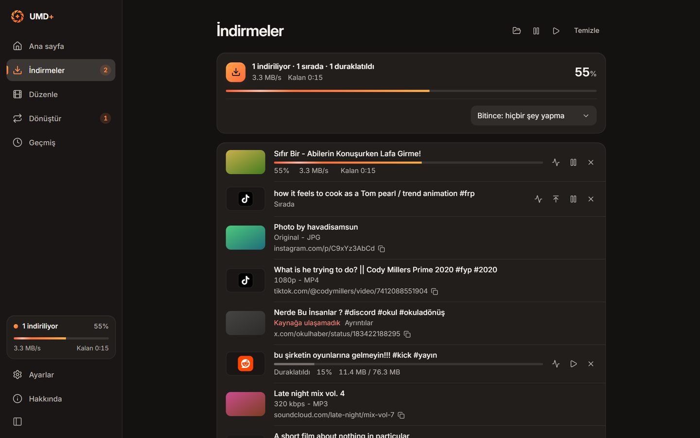

<p align="center">
  
</p>

<h1 align="center">Universal Media Downloader+</h1>

<p align="center">
  <b>Paste a link, download it.</b> Video, sound and photos from YouTube, TikTok, Instagram, X and many more.<br>
  No ads, no account, no tracking.
</p>

<p align="center">
  <a href="https://github.com/zearkreast/downloader-plus/releases/latest/download/UMD-Plus_x64-setup.exe"></a>
  <a href="https://github.com/zearkreast/downloader-plus/releases/latest/download/UMD-Plus_android_arm64.apk"></a>
  <a href="https://github.com/zearkreast/downloader-plus/releases/latest/download/UMD-Plus_x86_64.pkg.tar.zst"></a>
  <a href="#browser-extension"></a>
</p>

<p align="center">
  <a href="https://github.com/zearkreast/downloader-plus/releases/latest"></a>
  <a href="LICENSE"></a>
</p>

<p align="center">
  
</p>

## Which file do I need?

| Your device | Download |
| --- | --- |
| **Windows 10 / 11** | [`UMD-Plus_x64-setup.exe`](https://github.com/zearkreast/downloader-plus/releases/latest/download/UMD-Plus_x64-setup.exe) |
| **Android phone** (almost every phone) | [`UMD-Plus_android_arm64.apk`](https://github.com/zearkreast/downloader-plus/releases/latest/download/UMD-Plus_android_arm64.apk) |
| Older 32-bit Android phone | [`UMD-Plus_android_armv7.apk`](https://github.com/zearkreast/downloader-plus/releases/latest/download/UMD-Plus_android_armv7.apk) |
| **Arch Linux, CachyOS, EndeavourOS, Manjaro** | [`UMD-Plus_x86_64.pkg.tar.zst`](https://github.com/zearkreast/downloader-plus/releases/latest/download/UMD-Plus_x86_64.pkg.tar.zst) |
| **Chrome, Edge, Brave, Opera, Vivaldi** extension | [`extension-full.zip`](https://github.com/zearkreast/downloader-plus/releases/latest/download/extension-full.zip) |
| **Firefox** extension | [`extension-firefox.zip`](https://github.com/zearkreast/downloader-plus/releases/latest/download/extension-firefox.zip) |

The links always point at the newest build. Everything else, including an MSI
for managed installs and x86_64 Android, is on the
[releases page](https://github.com/zearkreast/downloader-plus/releases/latest).

## Install

<details>
<summary><b>Windows</b></summary>

1. Download `UMD-Plus_x64-setup.exe` and open it.
2. If a blue "Windows protected your PC" window appears, press **More info**, then **Run anyway**. It appears because the installer is not code-signed.
3. UMD+ opens when the installer finishes. No administrator rights are needed.

Installing over an earlier copy keeps your settings and history, and a copy
under the old name, Universal Downloader, is replaced. From then on the app
updates itself: it fetches the new installer in the background, checks it
against the checksum GitHub publishes, and installs it when nothing is
downloading.
</details>

<details>
<summary><b>Android</b></summary>



1. On the phone, download `UMD-Plus_android_arm64.apk`.
2. Tap the downloaded file. If Android asks about installing from this source, allow it.
3. Tap **Install**.

Android 7.0 or newer. If the upstream **Universal Downloader** app is
installed, uninstall it first: it has the same package name and a different
signature, so Android will not install this one over it.

To download from another app, press its **Share** button and pick UMD+.
Downloads land in `Download/Universal Downloader`. When a new version is out,
the app offers it as it opens.
<br clear="right">
</details>

<details>
<summary><b>Arch Linux and derivatives</b></summary>

Download the package, then install it from the folder it is in:

```bash
sudo pacman -U ./UMD-Plus_x86_64.pkg.tar.zst
```

yt-dlp and FFmpeg come with it from your distribution. For YouTube, add Deno:

```bash
sudo pacman -S deno
```

The package is unsigned, so pacman takes it from a file rather than a link. It
does not update itself: install a newer package the same way.
</details>

<details>
<summary id="browser-extension"><b>Browser extension</b></summary>

The extension sends what a tab is playing to the app. It works with the
Windows app, for now.

1. Unzip `extension-full.zip` into a folder you keep.
2. Open the extensions page: `chrome://extensions`, `edge://extensions` or `brave://extensions`.
3. Turn on **Developer mode**, press **Load unpacked** and pick the folder.

To update it, unzip the new file into the same folder and press **Reload** on
the extensions page. Firefox loads `extension-firefox.zip` as a temporary
add-on from `about:debugging`, until Firefox closes.
</details>

## What it does

**Downloading**
- Shows what a link really offers (title, creator, length and the actual qualities) and downloads the one you pick. A 720p video never shows a 4K option.
- Whole **playlists and channels**: they open in seconds, you tick the videos, and they land in a folder named after the list.
- **Photos** too: Instagram posts and carousels, X, TikTok photo posts, Reddit galleries and Pinterest pins, at full size.
- **Fast**: large files are split over several connections, and the queue can be paused, resumed and retried without losing progress.
- **Subtitles** beside the video or inside it, and the file's **title, creator, chapters and cover** written into it.

**Staying out of the way**
- A **speed limit** for all downloads together, and **scheduled hours** for the queue.
- When the queue runs out, the app can close, or the computer can sleep or shut down, after a countdown you can call off.
- Points out a link you have already downloaded.

**Working with files**
- **Converts** video, sound and pictures between the common formats, without re-encoding when it does not have to.
- **Cuts and joins** clips in the editor, against a waveform and a strip of frames.

**From the browser** (Windows)
- The extension lists what a tab is playing. Press **Get**, or right-click a link, a video or a page, or press `Alt+Shift+S`.
- Streams whose links work only inside their player are downloaded from what the player received.

<table>
  <tr>
    <td width="50%"></td>
    <td width="50%"></td>
  </tr>
  <tr>
    <td align="center"><sub>Pick the videos you want from a playlist</sub></td>
    <td align="center"><sub>Downloads, with speed and time left</sub></td>
  </tr>
</table>

## Download from a page

Some videos cannot be downloaded from their link, because the player's stream
address expires at once or answers only that player. Use the extension for these:

1. Open the page and play the video for a few seconds, at the quality you want.
2. Press the extension's icon, then **Get** on the video's row.
3. The app opens with the video. Check the options and start the download.

Keep the tab open until the download starts. Only the quality the player
loaded can be downloaded.

## Sites

YouTube, TikTok, Instagram, X, Reddit, Facebook, Twitch, Pinterest, Vimeo,
Dailymotion and SoundCloud, plus direct media files and most pages that publish
their media. A song shared from Spotify is downloaded as the same recording
published on YouTube.

Whether a link yields anything is up to the site: some keep parts of their
catalogue behind a sign-in, and the app says so plainly rather than pretending.

**What it deliberately does not do:** it contains no DRM circumvention, no
paywall or sign-in bypass and no watermark removal. Where a site offers a
version without a watermark, that one can be chosen.

## Privacy

No account, no ads, no analytics, no telemetry. Links are read by tools
running on your computer, and the app talks only to the site you are
downloading from and to GitHub, to fetch its tools and to check for updates.
When a phone's own DNS cannot find a site, the app asks Cloudflare's or
Google's public resolver for that one host name.

The browser extension sends nothing off your computer. What it reads is listed
in [`extension/PRIVACY.md`](extension/PRIVACY.md).

## For developers

Made with Tauri 2, React 19, TypeScript and Rust.

```
src/            the interface (React, TypeScript): screens in pages/, parts in components/
src-tauri/      the core (Rust): reading links, downloading, FFmpeg, the browser link,
                and the Android project in gen/android/
extension/      the browser extension: what ships in src/, its tests, its store listing
scripts/        tools for working on it: previews, packing, generators, release notes
packaging/      the Arch Linux package
docs/           for developers and releases, screenshots, release notes
.github/        the release workflow and the release page's template
```

[`docs/DEVELOPMENT.md`](docs/DEVELOPMENT.md) covers the architecture, building,
tests and where the app keeps its files.
[`docs/RELEASING.md`](docs/RELEASING.md) covers the release workflow.
[`scripts/README.md`](scripts/README.md) lists the tools, and
[`extension/README.md`](extension/README.md) explains the extension.

## Credits and licences

Built on [unsalable/downloader](https://github.com/unsalable/downloader) by
Melih. UMD+ is released under the [MIT License](LICENSE).

Third-party licences are listed in the app's About screen. Inter is used under
the SIL Open Font License. The phone's intro film uses
[Remotion](https://www.remotion.dev/license), which is free for individuals,
non-profits and companies of up to three people; a larger company building this
app needs a Remotion company licence.
